# RenovaHub

RenovaHub is a Laravel workspace where a homeowner, a designer, and a contractor plan and run the same renovation.

## Overview

A homeowner opens a project, records the property, budget, and timeline, and invites a designer and a contractor. The designer works from the brief through mood boards, concepts, and final files. The contractor prices the work, compares suppliers and construction firms, and tracks tasks, documents, and change requests. Approvals, messages, activity, and payment records stay on the project.

The interface is server-rendered Blade with Livewire components, styled with Tailwind CSS and built by Vite. Role middleware keeps each workspace on its own URL prefix.

## Links

| Resource | Location |
| --- | --- |
| Repository | [github.com/roshelpeter-cpu/renovahub](https://github.com/roshelpeter-cpu/renovahub) |
| Homeowner API notes | [docs/api-v1.md](docs/api-v1.md) |
| Health check | `GET /up` |
| Marketing contact shown on the site | `hello@renovahub.com`, Colombo |

The repository does not publish a hosted demo URL. The screenshots below were taken from a local run.

## Screenshot gallery

These images are the running application. Interior and exterior photographs inside the pages are project artwork stored under `public/images/`. They are part of the interface, and they are separate from the screenshot files in this gallery.

### Public site

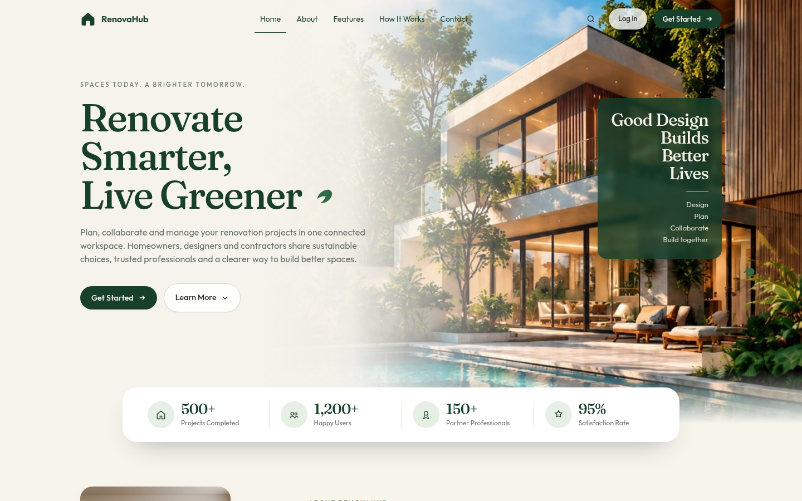

The marketing page introduces the product, with sign-in and registration in the header. The introduction video player stays on its poster fallback until `public/videos/renovahub-intro.mp4` is added. The `public/videos/` directory currently holds only a placeholder file.

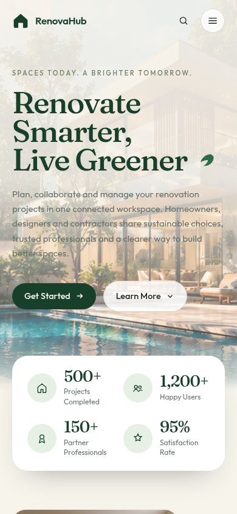

### Homeowner workspace

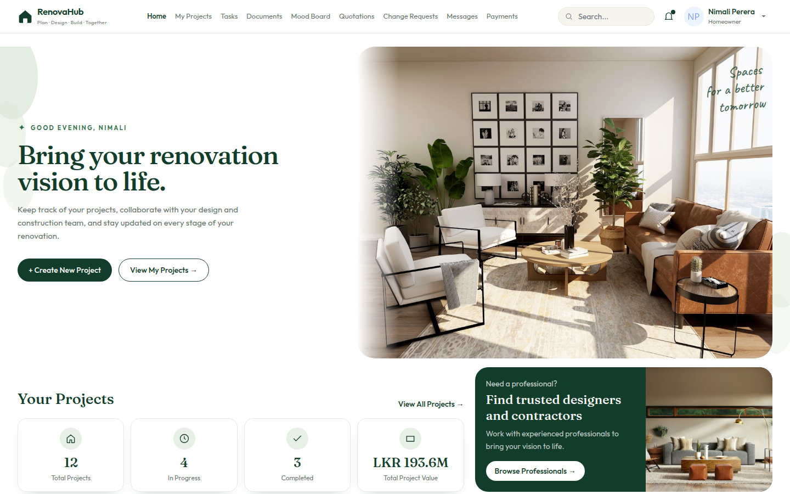

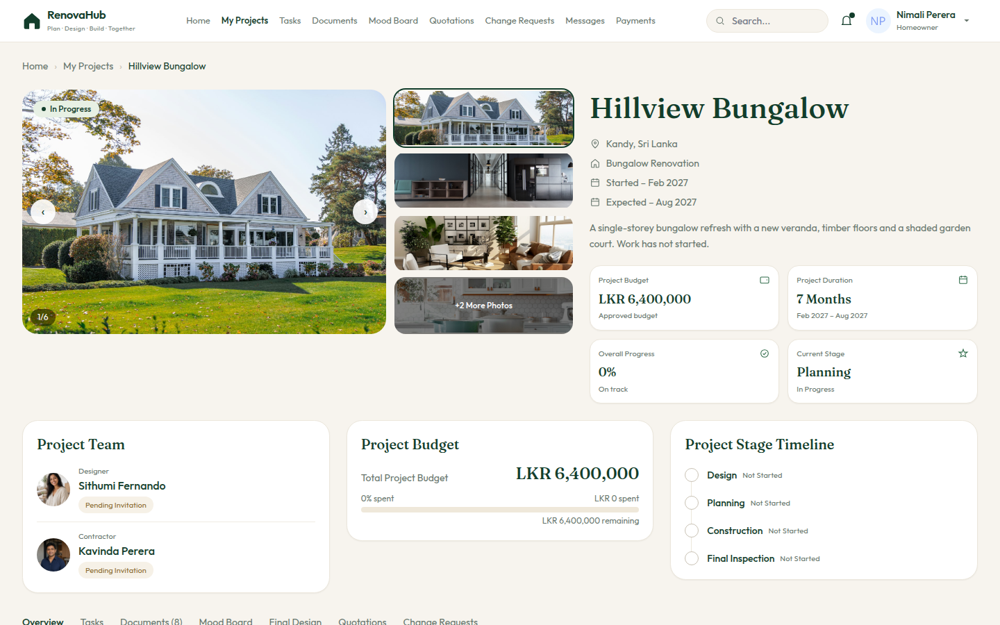

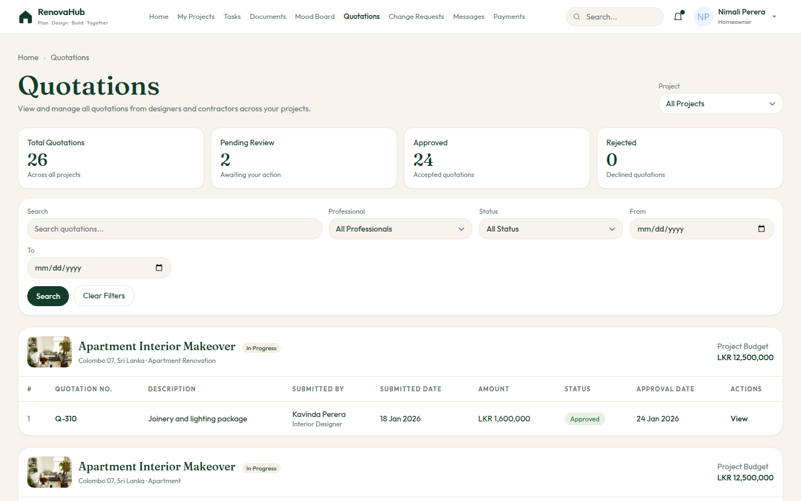

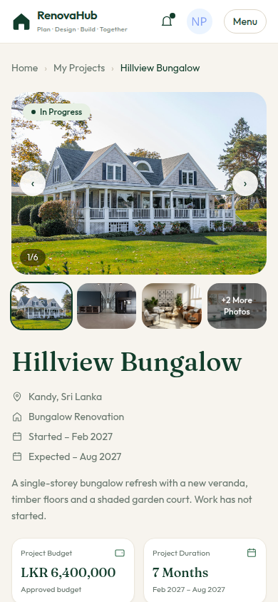

### Designer workspace

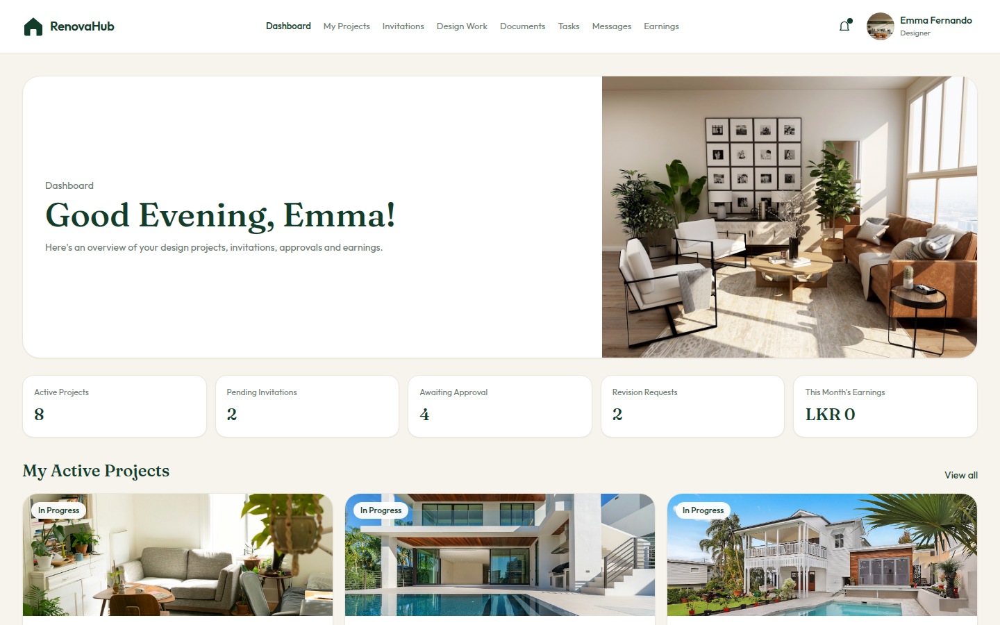

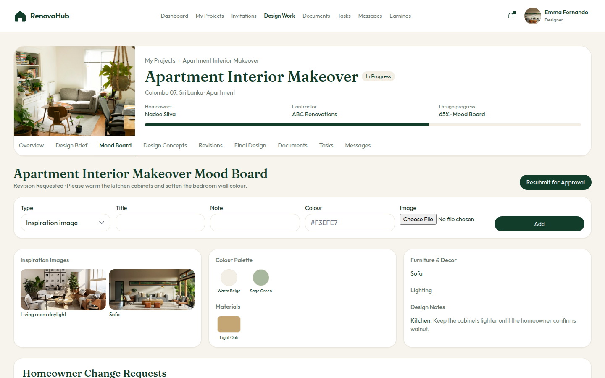

### Contractor workspace

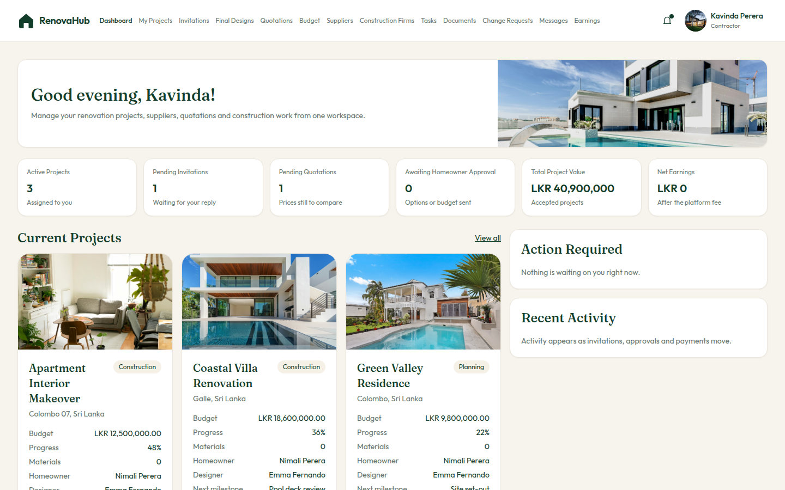

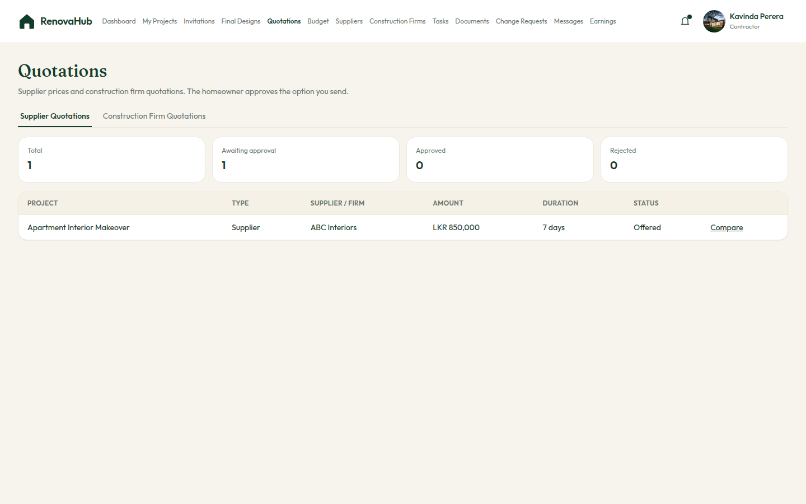

The gallery uses local demonstration accounts. Email addresses and passwords from the seeders are omitted here, and the captures do not show payment credentials.

## Problem and purpose

Renovation work is split across briefs, drawings, quotations, supplier prices, and messages. RenovaHub keeps that work on one project record so the homeowner can see who is invited, what is proposed, and which decisions are still open.

## Features

### Homeowner

- Create, update, and delete projects, with renovation type, property type, size, and a written brief.
- Store the property address, city, province, postal code, and optional coordinates. Location text is saved as entered. It is not sent to a geocoding service.
- Set the estimated budget, dates, and timeline notes. Project stages cover design, planning, construction, and final inspection.
- Invite and assign a designer and a contractor, and review invitation status on the project.
- Browse a professional directory, open portfolios, save favourites, and start a conversation.
- Review tasks, upload and download documents, and read the project activity log.
- Review mood boards and final design files, approve them, or request changes.
- Decide on design concepts.
- Review quotations and approve or reject them.
- Decide on procurement proposals and submitted budgets.
- Open change requests and, on a completed project, leave feedback.
- Exchange project messages and use the conversation inbox.
- View payment records and receipts. Checkout behaviour is described under external integrations.
- Read and mark notifications.

The homeowner navigation is Home, My Projects, Tasks, Documents, Mood Board, Quotations, Change Requests, Messages, and Payments.

### Designer

- Accept or reject project invitations and open accepted work.
- Read the project brief.
- Build a mood board, submit it, and respond when the homeowner asks for changes.
- Create design concepts and submit them for a decision.
- Upload final design files and material notes, then submit the package.
- Accept, reject, or resubmit revision requests.
- Upload documents and update design tasks.
- Read project and inbox messages.
- View recorded earnings.
- Edit the designer profile and portfolio.

### Contractor

- Accept or reject invitations and open assigned projects.
- Read final designs and material requirements.
- Prepare quotations and submit them to the homeowner.
- Maintain the project budget and submit it for approval.
- Request supplier prices, compare offers, and place supplier orders.
- Collect construction-firm quotations, compare them, and assign a firm.
- Create and update tasks, and upload documents.
- Respond to change requests.
- Read messages and review earnings, including allocation records created from a verified payment.

### Shared application behaviour

- Registration asks for one role: homeowner, designer, or contractor.
- Sign-in, password reset, password confirmation, two-factor authentication, and passkeys come from Laravel Fortify.
- Account deletion is enabled in Jetstream. Jetstream teams, profile photos, and the API-token screen are turned off.
- Each workspace is wrapped in its own middleware alias: `homeowner`, `designer`, or `contractor`. Policies check project membership again on the action.
- `/dashboard` sends a designer or contractor to that role's dashboard. A homeowner sees the homeowner home.
- An authenticated JSON API under `/api/v1` lets a homeowner list and update owned projects and their tasks, documents, quotations, change requests, messages, payments, and notifications. See [docs/api-v1.md](docs/api-v1.md).

## Roles

| Role | Entry | What the role owns |
| --- | --- | --- |
| Homeowner | `/homeowner` | The project, team invitations, design decisions, quotation decisions, and payment records |
| Designer | `/designer/dashboard` | The brief response: concepts, mood board, final files, revisions, and design tasks |
| Contractor | `/contractor/dashboard` | Site delivery: quotations, budget, suppliers, construction firms, tasks, and change responses |

A person has one role, stored on `users.role`. Google sign-in matches an existing email. A visitor who has no RenovaHub account is sent to registration to choose a role. The Google callback does not insert a user.

## Technology stack

Versions below are the versions locked or declared in this repository.

| Layer | Choice |
| --- | --- |
| Language | PHP `^8.4` (`composer.json`). The application booted on PHP 8.4 during this documentation pass |
| Framework | Laravel 13.34, Jetstream 5.5 (Livewire stack), Fortify, Sanctum 4.3 |
| UI | Blade, Livewire 3.8, Tailwind CSS 3.4, Vite 8 |
| Frontend runtime | Node.js `^20.19.0` or `>=22.12.0`, from Vite's engine requirement. The container asset stage uses Node 22 |
| Authentication | Session guard through Sanctum, plus Laravel Socialite 5.31 for Google |
| Database | MySQL in `.env.example`. PHPUnit uses SQLite in memory. GitHub Actions uses a SQLite file |
| Cache and queue | Redis in `.env.example` |
| Mail | `log` mailer in `.env.example` |
| Tests | PHPUnit 12, `php artisan test` |
| Container | `Dockerfile` for a Render-style image. There is no `docker-compose` file |

`package.json` also declares `@tailwindcss/vite` 4. `vite.config.js` does not register that plugin. Styles are built with Tailwind CSS 3 through PostCSS (`postcss.config.js` and the `@tailwind` directives in `resources/css/app.css`).

## Architecture

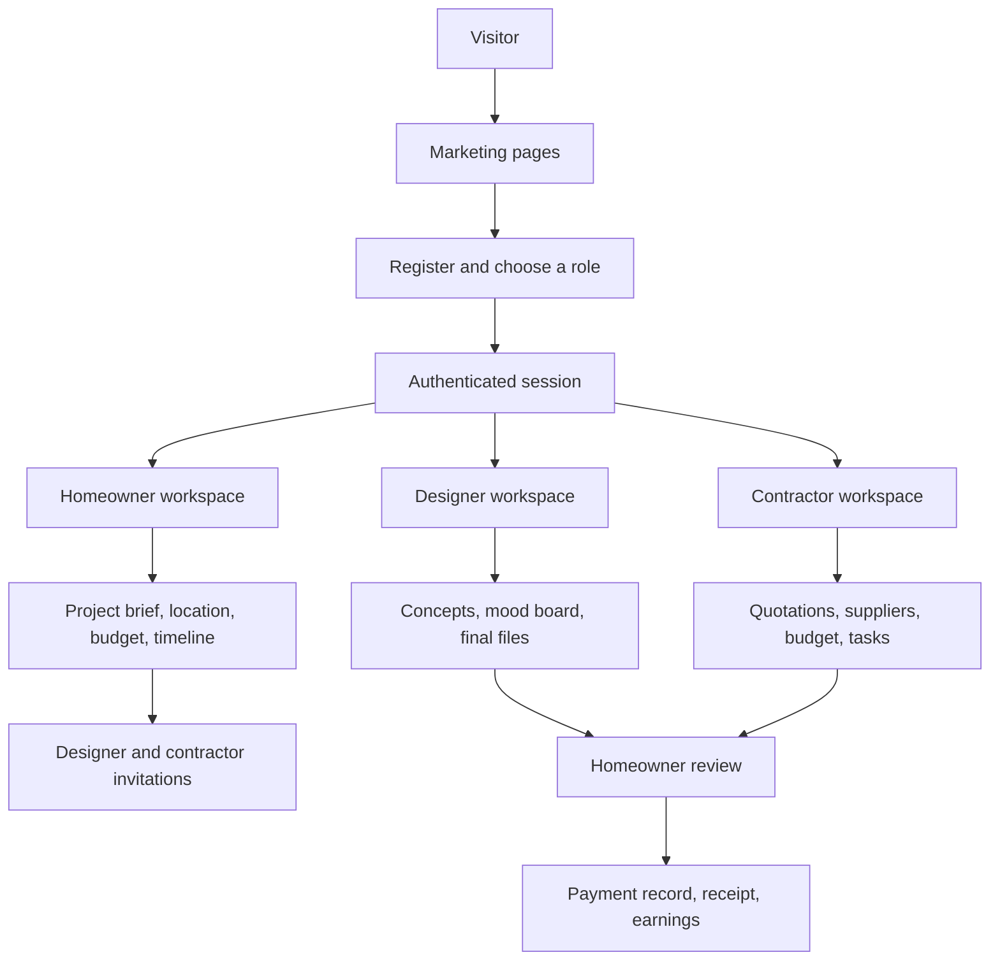

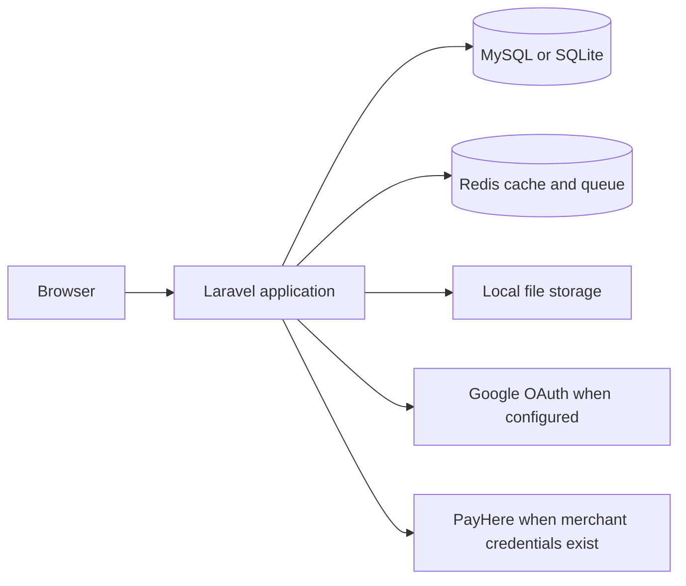

Requests enter through `public/index.php`. Web routes live in `routes/web.php`. JSON routes live in `routes/api.php`. Controllers delegate project, payment, procurement, and workspace work to classes in `app/Services/`. Eloquent models and policies sit beside them. Views are grouped by role under `resources/views/homeowner`, `resources/views/designer`, and `resources/views/contractor`.

## Repository structure

```text
renovahub/
├── app/
│   ├── Actions/Fortify/          Registration and profile actions
│   ├── Http/Controllers/         Homeowner, designer, contractor, and Api/V1
│   ├── Http/Middleware/          Role gates
│   ├── Http/Requests/            Form validation
│   ├── Models/
│   ├── Policies/
│   └── Services/                 Projects, payments, procurement, workspaces
├── bootstrap/app.php             Routing, middleware aliases, API error JSON
├── database/
│   ├── migrations/
│   ├── seeders/                  Demonstration workspace data
│   └── factories/
├── docker/                       Nginx template, PHP config, container start script
├── docs/
│   ├── api-v1.md
│   └── screenshots/
├── public/                       Front controller and image artwork
├── resources/
│   ├── css/app.css
│   ├── js/
│   └── views/
├── routes/web.php
├── routes/api.php
├── tests/Feature/
├── tests/Unit/
├── Dockerfile
├── composer.json
└── package.json
```

## Prerequisites

- PHP 8.4 with `pdo_mysql` or `pdo_sqlite`, `mbstring`, `bcmath`, `intl`, `xml`, `zip`, `curl`, and `fileinfo`
- Composer 2
- Node.js `^20.19.0` or `>=22.12.0`, with npm
- MySQL, if you keep the database settings from `.env.example`
- Redis, if you keep the cache and queue settings from `.env.example`

PHP 8.3 cannot boot the locked dependencies. Symfony 8.1, pulled in by Laravel 13.34, uses PHP 8.4 property hooks. `composer.json` already requires `php: ^8.4`.

## Local installation

```bash
git clone https://github.com/roshelpeter-cpu/renovahub.git
cd renovahub
composer install
cp .env.example .env
php artisan key:generate
```

Create the MySQL database named in `DB_DATABASE`, then:

```bash
php artisan migrate
npm ci
npm run build
```

`composer setup` runs that sequence for you: install PHP dependencies, copy `.env` when it is missing, generate the key, migrate, install npm packages, and build assets. Point the database at a server you control before running it. The command uses `migrate --force`.

## Environment

`.env.example` is the template. Fill secrets on your machine. Do not commit `.env`.

| Variable | Role in this application |
| --- | --- |
| `APP_NAME` | Display name. The example uses `RenovaHub` |
| `APP_URL` | Absolute URL used for links and OAuth redirects |
| `APP_KEY` | Generated locally with `php artisan key:generate` |
| `DB_CONNECTION` | `mysql` in the example file |
| `DB_HOST`, `DB_PORT` | MySQL host and port. The example uses `127.0.0.1` and `3306` |
| `DB_DATABASE` | Example name: `renovahub` |
| `DB_USERNAME`, `DB_PASSWORD` | Database account. The example username is `root` and the password is left blank for a local server |
| `SESSION_DRIVER` | `database`. Run migrations before signing in |
| `QUEUE_CONNECTION` | `redis` |
| `CACHE_STORE` | `redis` |
| `FILESYSTEM_DISK` | `local` |
| `MAIL_MAILER` | `log`. Password-reset and other mail is written to the log until another mailer is configured |
| `REDIS_HOST`, `REDIS_PORT` | Redis used by the default cache and queue |
| `PAYHERE_MERCHANT_ID` | Required before a real PayHere checkout form is built |
| `PAYHERE_MERCHANT_SECRET` | Used to sign PayHere requests and notifications. Leave it empty in source control |
| `PAYHERE_SANDBOX` | Example value `true`. Selects the PayHere sandbox host when credentials exist |
| `PAYHERE_RETURN_URL`, `PAYHERE_CANCEL_URL`, `PAYHERE_NOTIFY_URL` | Present in the example file and in `config/services.php`. The checkout form currently fills return, cancel, and notify with named application routes |

Google sign-in reads three further variables from `config/services.php`. They are not listed in `.env.example`:

| Variable | Purpose |
| --- | --- |
| `GOOGLE_CLIENT_ID` | Google OAuth client |
| `GOOGLE_CLIENT_SECRET` | Google OAuth secret |
| `GOOGLE_REDIRECT_URI` | Must match the Google client. The callback route is `/auth/google/callback` |

## Database

Default local development uses MySQL. Migrations create users, sessions, cache, jobs, projects, invitations, tasks, documents, mood boards, design files, quotations, supplier prices, orders, payments, messages, notifications, and the related workspace tables.

```bash
php artisan migrate
```

Demonstration records:

```bash
php artisan db:seed
```

`DatabaseSeeder` creates a basic homeowner and then calls `DemoDataSeeder`, which loads homeowner, professional, project, quotation, document, mood board, message, payment, designer, and contractor demonstration records. Passwords stay in the seeder classes and are hashed before storage. This README does not repeat them.

`ContractorWorkspaceSeeder` places sample supplier orders through `SupplierOrderService`. An offer can be ordered only while its status is offered and `valid_until` is still today or later. The sample offer date in that seeder is 25 October 2026. Seeding after that date stops with an HTTP 422 inside the contractor seeder, after the earlier demonstration seeders have already written their records.

Tests and continuous integration do not need MySQL:

- `phpunit.xml` sets `DB_CONNECTION=sqlite` and `DB_DATABASE=:memory:`.
- `.github/workflows/ci.yml` copies `.env.example`, switches it to a SQLite file, migrates, and runs the test suite on PHP 8.4.

A SQLite file is a practical local substitute when MySQL is unavailable. Set `DB_CONNECTION=sqlite` and `DB_DATABASE` to a file path, and create that file before migrating. For a machine without Redis, set `CACHE_STORE=file` and `QUEUE_CONNECTION=sync`. Those overrides belong in your uncommitted `.env`.

## Run and development

Production-style assets, then the PHP server:

```bash
npm run build
php artisan serve
```

The combined development command starts the HTTP server, a queue listener, and Vite together:

```bash
composer dev
```

That listener expects the Redis queue from `.env.example`. Asset URLs during `npm run dev` come from the Vite dev server. `npm run build` writes the manifest under `public/build/`, which is gitignored.

Useful routes after sign-in:

| Workspace | URL |
| --- | --- |
| Marketing site | `/` |
| Sign in | `/login` |
| Register | `/register` |
| Homeowner home | `/homeowner` |
| Designer dashboard | `/designer/dashboard` |
| Contractor dashboard | `/contractor/dashboard` |
| API | `/api/v1/projects` |

Workspace routes use `auth:sanctum`, the Jetstream session middleware, and Laravel's `verified` middleware. Fortify's email-verification feature is commented out in `config/fortify.php`, and `User` does not implement `MustVerifyEmail`, so verification is not enforced for these accounts.

## Testing

Feature tests cover registration and authentication, Google sign-in, the homeowner project and workspace flows, the designer workspace, the contractor workspace, and payment confirmation. API token, profile, password, and two-factor tests from the Jetstream stack are included as well.

```bash
composer test
```

The same entry point is `php artisan test`. Both use the in-memory SQLite settings in `phpunit.xml`. GitHub Actions runs that suite on pushes and pull requests to `main`.

This documentation change does not report a test result. Run the command above on a PHP 8.4 checkout to see the current suite.

## External integrations and limitations

**PayHere.** A payment row is created in RenovaHub when a quotation, supplier order, or approved budget needs one. The row stores the amount, platform fee, currency (LKR unless the project sets another), and status. `Payment::FEE_PERCENT` is `2` for quotation-based payments.

Checkout has two paths in `PaymentService::checkout()`:

- With both `PAYHERE_MERCHANT_ID` and `PAYHERE_MERCHANT_SECRET`, the pay page posts a signed form to PayHere. `PAYHERE_SANDBOX=true` uses `https://sandbox.payhere.lk/pay/checkout`. Setting it to false uses `https://www.payhere.lk/pay/checkout`. The payment becomes paid only after `POST /payments/payhere/notify` validates the PayHere signature and the paid amount.
- With either credential empty, which is the example environment, the pay page uses a local HMAC confirmation token. Confirming that form marks the row paid inside RenovaHub and stores a `sandbox-…` provider reference. No charge is sent to PayHere.

Opening the checkout page does not mark a payment paid. There is no browser field that can set the status directly.

**Google.** `/auth/google` redirects through Socialite. The callback signs in a user whose email already exists. Missing client id, secret, or redirect URI means the redirect cannot complete. Failed provider calls return the person to the login page.

**Mail.** The example mailer is `log`, so messages are not delivered to an inbox until `MAIL_*` is pointed at a real transport.

**Maps and directories.** Project location is manual. The homeowner API notes in `docs/api-v1.md` also record that those routes do not call Google Places, a payment provider, or Brevo.

**Jetstream API screen.** Sanctum is installed and `/api/v1` is active, but `Features::api()` is commented out, so Jetstream's token-management page is not registered. A bearer token has to be created through Sanctum outside that screen.

**Container image.** `Dockerfile` builds assets with `node:22-bookworm-slim` and runs `php:8.3-fpm` plus Nginx on port `10000`. Composer is installed with `--ignore-platform-req=php`. `docker/start.sh` links storage, caches configuration, and runs `php artisan migrate --force`. There is no compose file for MySQL or Redis beside that image. Because the locked framework syntax requires PHP 8.4, use a PHP 8.4 runtime for local work. The image as written still pins PHP 8.3.

**Marketing figures and video.** Counts shown on the public homepage are page content. They are not computed from the database. The introduction video file is not in the repository.

## Author

RenovaHub is published by [roshelpeter-cpu](https://github.com/roshelpeter-cpu). The application extends a Laravel Jetstream skeleton. Framework packages remain under their own licenses. `composer.json` still carries the skeleton's MIT license field.
